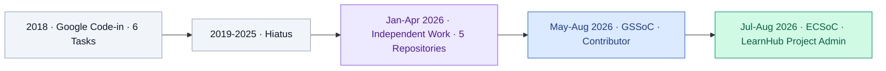
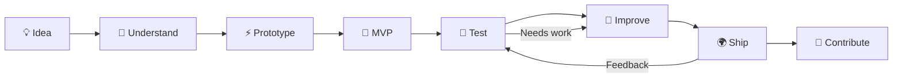

 

  
  
  
  

 

## About Me 🙋‍♂️

<table>
<tr>
<td width="60%" valign="top">

I mostly learn by breaking things, then figuring out why they broke.

That habit has taken me through full stack apps, a few MVPs, some cloud experiments that failed before they worked, and a growing list of open source repos, some I built from scratch, some I just showed up and contributed to.

Give me a codebase I've never seen before and I'll happily spend a weekend finding my way around it. Not because it's easy. Because that's usually how I actually learn something.

</td>

<td width="40%" valign="top">

<pre>
$ ./about-me.sh

[+] exploring codebases
[+] breaking things
[+] debugging
[+] understanding why
[+] building again

$ git status
On branch learning

STATUS=STILL_BUILDING
</pre>

</td>
</tr>
</table>

## Open Source 💡

I did <a href="https://codein.withgoogle.com/archive/2018/"><b>Google Code-in back in 2018</b></a>, completed 6 tasks, and ended up with a certificate and a Google t-shirt for it. Then I didn't touch open source again for six years. Picked it back up in January 2026, first on my own, then through GSSoC and ECSOC.

 

<table>
<tr>

<td align="center" width="300">

<h3>🩷 GSSoC '26</h3>

  

  

</td>

<td align="center" width="300">

<h3>🟩 ECSOC 2026</h3>

  

  

  

</td>

</tr>
</table>

 

&nbsp;

 

## The Journey So Far

## Things I've Built 🪄

<table>
<tr>

<td align="center" width="280">

<h3>🎓 LearnHub</h3>

  
An open source learning platform I run as project admin, handling issues, PRs, and contributor onboarding.
  

</td>

<td align="center" width="280">

<h3>🔐 Credify</h3>

  
Verifies academic credentials so no one has to call a university registrar to check if a degree is real.
  

</td>

<td align="center" width="280">

<h3>🏫 CampusEventHub</h3>

  
A MERN app for running campus events without ten WhatsApp groups and a lost Google Form.
  

</td>

</tr>
</table>

 

## Where Else I've Shipped Code 🔥

<table>
<tr>
<th>Repository</th>
<th>What I worked on</th>
</tr>

<tr>
<td><a href="https://github.com/Dev-Card/DevCard"><b>🃏 DevCard</b></a></td>
<td>

</td>
</tr>

<tr>
<td><a href="https://github.com/JhaSourav07/commitpulse"><b>💓 CommitPulse</b></a></td>
<td>

</td>
</tr>

<tr>
<td><a href="https://github.com/nevinshine/telos-runtime"><b>⚙️ Telos Runtime</b></a></td>
<td>

</td>
</tr>

<tr>
<td><a href="https://github.com/anubhavxdev/Event-management-system-main"><b>🎪 Event Management System</b></a></td>
<td>

</td>
</tr>

<tr>
<td><a href="https://github.com/geturbackend/urBackend"><b>🔧 urBackend</b></a></td>
<td>

</td>
</tr>

</table>

 

 

## What I Actually Use 🛠️

<h3>⚛️ Frontend</h3>

<h3>⚙️ Backend</h3>

<h3>☁️ Cloud & DevOps</h3>

<h3>🤖 AI & Data</h3>

 

## How I Actually Work 🧠 

It starts with an idea, then I try to understand what I'm actually solving before I touch code. Then a rough prototype, usually ugly, usually broken in at least one place. Once it does the basic thing, it becomes an MVP. Testing finds the stuff I missed. Then I fix it and ship it, and if anyone else is using it, they tell me what's still broken. Repeat.

 

## Right Now 

  

Building, contributing where I can be useful, and figuring the rest out as I go.

 

## Reach Me 🔗

&nbsp;

&nbsp;

&nbsp;

 

<i>Build it. Break it. Fix it. Ship it. Do it again.</i>

  

