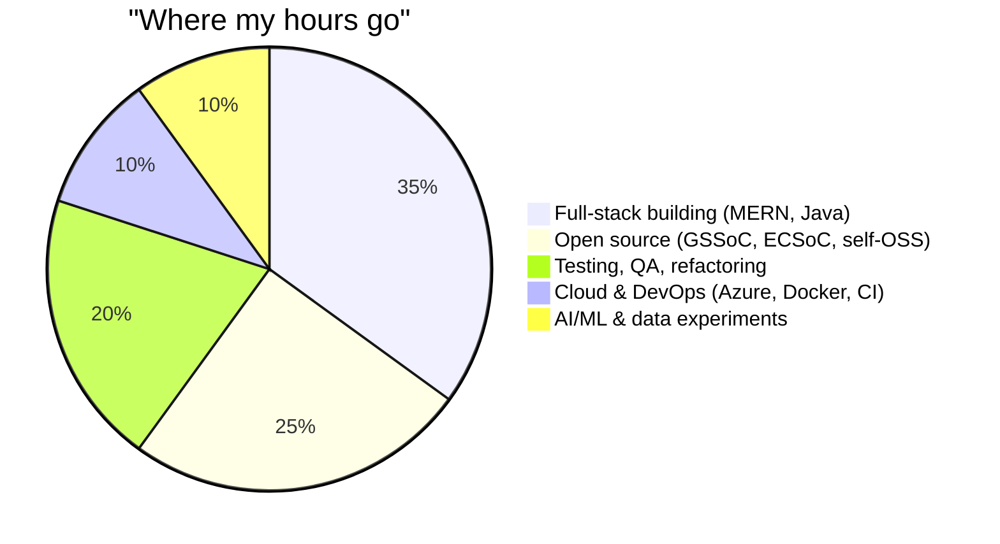
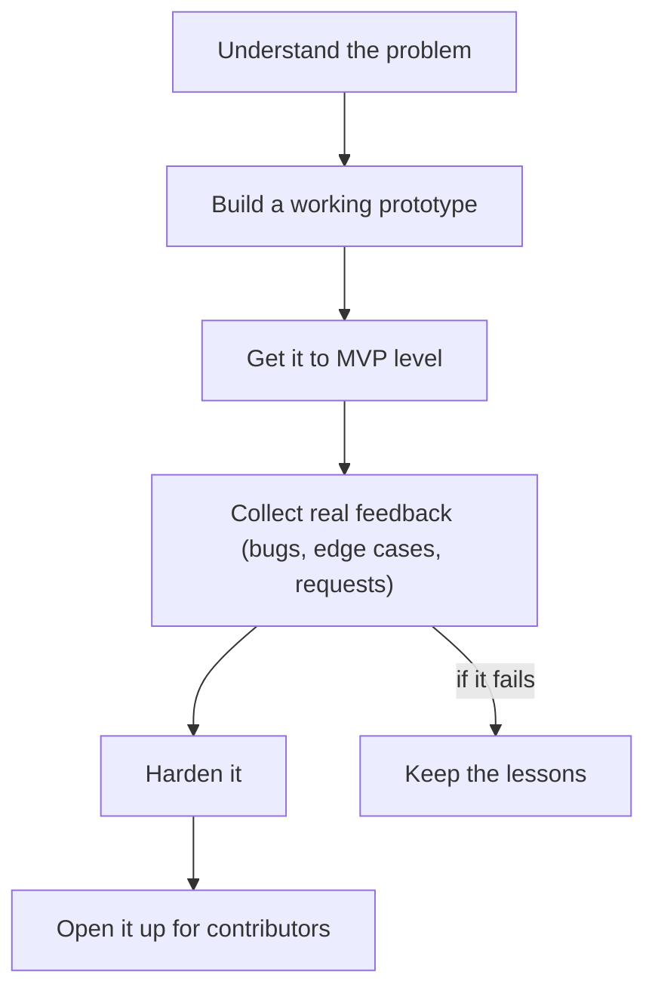

<div align="center">

<pre>
╭──────────────────────────────────────────────────────────────╮
│                                                              │
│                 HI 👋, I'M SOMAPURAM UDAY                   │
│                                                              │
│      I build full-stack products, prototypes &               │
│              MVP's that solve real problems.                 │
│                                                              │
╰──────────────────────────────────────────────────────────────╯
</pre>

</div>

<div align="center">
  <a href="https://udaycodespace.github.io">
    
  </a>
  <a href="https://udaycodespace.github.io/open-source/">
    
  </a>
  <a href="https://linkedin.com/in/somapuram-uday">
    
  </a>
</div>

```console
uday@github:~$ ./whoami

USER         : Somapuram Uday
ROLE         : Full-stack Developer
LOCATION     : India
CURRENT ROLE : Technology Consultant @ Meteoros Automation LLP

STACK        : MERN · Java/Spring · Python · Azure · Docker
FOCUS        : Building production-ready MVPs, OSS, Cloud & AI
```

> I learn fastest by building real applications to the prototype/MVP stage, not by watching tutorials on repeat.

<br/>

### Right now I'm...

```text
[✓] Leading LearnHub as ECSoC 2026 Project Admin
[✓] Technology Consultant at Meteoros Automation LLP (Azure)
[✓] GSSoC 2026 contributor (Top 1% · 50+ PRs · 10+ repositories)
[✓] Converting internship and college projects into long-term open source
[~] Deepening my Azure, cloud infrastructure, and DevOps skills
[~] Improving documentation and contributor experience across my repos
```

<br/>

### How my time actually gets used



<br/>

## Prototypes and MVPs that matter

| Project | What it tackles | My role | Stack |
|--------|-----------------|---------|-------|
| [LearnHub](https://github.com/udaycodespace/learnhub) | E-learning platform that students, instructors, and admins can adapt and extend. | End-to-end dev · Maintainer · ECSoC 2026 project admin | React · Node.js · Express · MongoDB · Docker |
| [Credify](https://github.com/udaycodespace/credify) | Slow, manual, forge-prone academic credential verification. | Project lead · Backend/blockchain · DevOps | Python · Flask · IPFS · RSA · Docker |
| [CampusEventHub](https://github.com/udaycodespace/CampusEventHub) | Events scattered across WhatsApp, posters, and random forms. | Lead dev during Infosys Springboard · OSS cleanup | React · Node.js · Express · MongoDB |

<details>
<summary><b>Side experiments that changed how I build</b></summary>

- 🎛️ <a href="https://github.com/udaycodespace/terminal-portfolio">Terminal Portfolio</a>: command-line style portfolio (HTML, CSS, JS, GSAP, Three.js)
- 📊 <a href="https://github.com/udaycodespace/cosmetic-insights">Cosmetic Insights Dashboard</a>: SQL + Tableau consumer trends dashboard
- 🤖 AI/ML sandboxes: sentiment analysis (CNN), YOLOv8 object detection, user behaviour analysis notebooks

</details>

<br/>

## Open source is where I validate my engineering

```console
uday@github:~$ ./oss-status

GSSoC 2026    : Top 1% globally
PRs merged    : 50+
Repos touched : 10+
Focus         : Features · Testing · Security · Refactoring · Documentation
```

```text
Testing & QA                  40%  ████████████████████
Features & UI                 25%  ████████████
Performance & refactoring     15%  ████████
Security hardening            10%  █████
Docs & small bug fixes        10%  █████
```

**Repos I've pushed real changes to:**

| Repo | What I did |
|------|-----------|
| [Dev-Card/DevCard](https://github.com/Dev-Card/DevCard) | Feature work, performance tweaks, stronger test coverage. |
| [JhaSourav07/commitpulse](https://github.com/JhaSourav07/commitpulse) | Expanded tests, fixed bugs, cleaned up dashboard logic. |
| [nevinshine/telos-runtime](https://github.com/nevinshine/telos-runtime) | Worked on runtime security hooks and refactored core components. |
| [anubhavxdev/Event-Management](https://github.com/anubhavxdev/Event-management-system-main) | Added role-aware security flows and improved event workflows. |
| [geturbackend/urBackend](https://github.com/geturbackend/urBackend) | Fixed auth/token issues, tightened error handling, and improved docs. |

More here: <https://udaycodespace.github.io/open-source/>

<br/>

## How I build



- Start from the problem and who actually has it.
- Build a working prototype, then push it to an MVP that survives real use (internships, college, OSS).
- Harden it so someone else can clone, run, and contribute without a private tour from me.

<br/>

## Let's build something useful

- You want someone who can turn a vague problem statement into a working prototype or MVP, not just talk about patterns.
- You care about real code in real repos, open to contributions, with tests and docs improving over time.
- You're fine with "I haven't done X in production yet, but I'll learn it fast by building with you."

If that's you:

- Portfolio: <https://udaycodespace.github.io>
- Projects: [LearnHub](https://github.com/udaycodespace/learnhub) · [Credify](https://github.com/udaycodespace/credify) · [CampusEventHub](https://github.com/udaycodespace/CampusEventHub)
- Open source: <https://udaycodespace.github.io/open-source/>
- Contact: <mailto:udayworksoffical@gmail.com>

> Open an issue, send a PR, or drop a message if you want to build something real enough to learn from.
