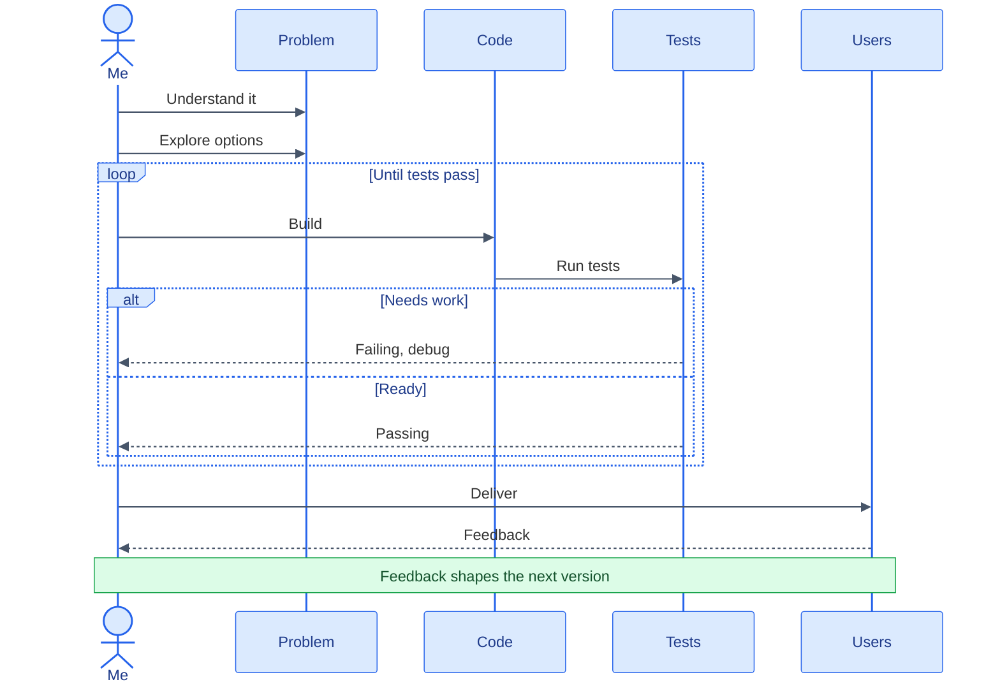

 

  
  
  
  

 

## About me 🙋‍♂️

<table>
<tr>
<td width="60%" valign="top">

I build **full-stack applications and AI-powered solutions** using Microsoft technologies.

My current focus is **Agentic AI, Azure AI Foundry, and cloud engineering**. I'm exploring how AI agents use models, tools, and workflows to solve practical problems.

I also contribute to open source and enjoy working across the stack, from application code to cloud services.

**My approach:** Learn by building. Understand by experimenting. Improve by solving problems.

</td>

<td width="40%" valign="top">

<pre>
$ whoami

UDAY

$ cat focus.txt

Agentic AI
Azure AI Foundry
Cloud Engineering
Full-Stack Development
Open Source

$ cat mindset.txt

Build > Experiment > Improve

$ echo $STATUS

EXPLORING WHAT'S NEXT
</pre>

</td>
</tr>
</table>

---

## Open source 💡

My open-source journey started with Google Code-in in 2018, where I completed 6 tasks and received a certificate and an official Google T-shirt.

I took a break after that and returned in 2026. This time, I worked on independent projects, contributed to different repositories, and helped manage an open-source project.

### Milestones 🏁

<table>
<tr>

<td align="center" width="33%">

<h3>Google Code-in 2018</h3>

  

  

  

  

  

</td>

<td align="center" width="33%">

<h3>GSSoC 2026</h3>

  

  

  

  

  

</td>

<td align="center" width="33%">

<h3>ECSoC 2026</h3>

  

  

  

  

  

</td>

</tr>
</table>

---

## Things I've built 🪄

I enjoy building projects that solve practical problems.

<table>
<tr>

<td align="center" width="280">

<h3>LearnHub 🎓</h3>

  
An open-source learning platform. I manage the project, review contributions, handle issues, and help new contributors get started.
  

</td>

<td align="center" width="280">

<h3>Credify 🔐</h3>

  
A project that helps verify academic credentials. It aims to make checking certificates easier and reduce the need for manual verification.
  

</td>

<td align="center" width="280">

<h3>CampusEventHub 🏫</h3>

  
A MERN application for managing campus events, making it easier to organize events and share information in one place.
  

</td>

</tr>
</table>

---

## Where else I've contributed 🔥

I also work on projects maintained by other developers: fixing bugs, improving features, testing, and updating documentation.

<table>
<tr>
<th>Repository</th>
<th>Areas of contribution</th>
</tr>

<tr>
<td><a href="https://github.com/Dev-Card/DevCard"><b>DevCard</b></a> 🃏</td>
<td>

</td>
</tr>

<tr>
<td><a href="https://github.com/JhaSourav07/commitpulse"><b>CommitPulse</b></a> 💓</td>
<td>

</td>
</tr>

<tr>
<td><a href="https://github.com/nevinshine/telos-runtime"><b>Telos Runtime</b></a> ⚙️</td>
<td>

</td>
</tr>

<tr>
<td><a href="https://github.com/anubhavxdev/Event-management-system-main"><b>Event Management System</b></a> 🎪</td>
<td>

</td>
</tr>

<tr>
<td><a href="https://github.com/geturbackend/urBackend"><b>urBackend</b></a> 🔧</td>
<td>

</td>
</tr>

</table>

 

---

## Technologies I use 🛠️

<h3>Frontend ⚛️</h3>

<h3>Backend ⚙️</h3>

<h3>Cloud and DevOps ☁️</h3>

<h3>AI and agents 🤖</h3>

---

## How I work 🔁

I don't start by writing code right away. First I understand the problem, then I explore options, build one, and test it. If it fails, I debug and try again. Once it works, I deliver it and use feedback to improve the next version.

---

## Let's connect 🤝

Interested in **Agentic AI, Azure, full-stack development, or open source?** Feel free to explore my work or reach out.

<a href="https://udayworks.me">Portfolio</a> ·
<a href="https://www.linkedin.com/in/somapuram-uday">LinkedIn</a> ·
<a href="https://github.com/udaycodespace">GitHub</a> ·
<a href="mailto:udaysomapuram@gmail.com">Email</a>

 

<h3>limₓ→∞ f(x) = ∞</h3>

Always building. Always learning. Never the final version.

